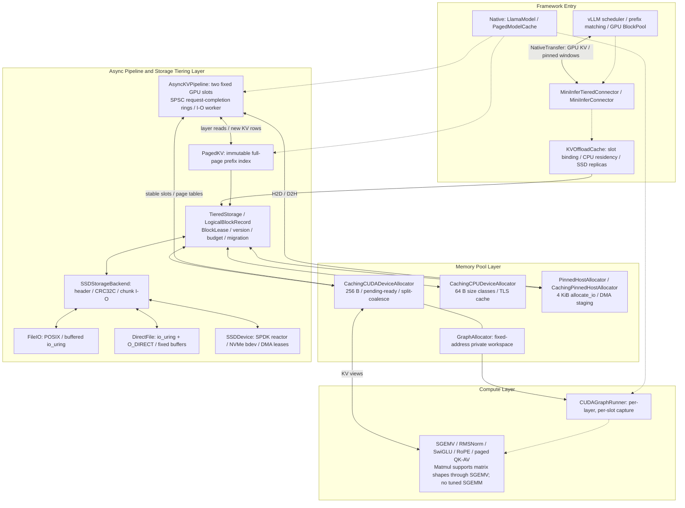
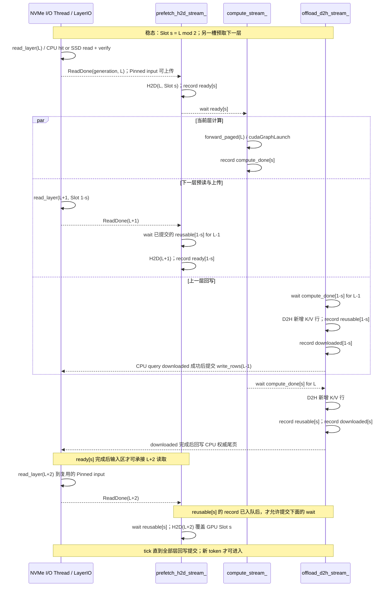

# MiniInfer · 分层 KV Cache 推理与高性能存储

**面向长上下文与多级 KVCache 卸载的高性能 C++17 / C11 / CUDA 推理与存储系统。**

MiniInfer 将自定义 CUDA Kernels、CUDA Graph、对齐内存池、Compute / I/O 双缓冲流水线、CPU / GPU / SSD 分层存储和 vLLM Connector 接在同一套资源与完成语义上：计算消费有效 KV，存储负责版本与迁移，内存池只在使用结束后复用地址。它既提供可独立运行的原生 Llama 推理路径，也提供可嵌入其他引擎的存储库和 C ABI。

```text
CUDA Kernels + CUDA Graph
          ↕
CPU / Pinned / CUDA Pools：64 B 主机小块、4 KiB I/O、256 B 显存对齐
          ↕
Layer-wise Double Buffering：I/O worker + H2D / Compute / D2H streams
          ↕
GPU ↔ CPU / Pinned ↔ SSD：POSIX / io_uring + O_DIRECT / SPDK NVMe
          ↕
Native Paged KV / vLLM Prefix Cache Connector
```

**已有证据：**RTX 5060 Ti 合成 FP32 模型的按层 CUDA Graph 实验中，TPOT 中位数由 **1791.69 μs 降至 1254.81 μs**；4 KiB 页合批 I/O、真实 NVMe 的 SPDK / CUDA 主机 DMA 路径均有独立记录。不同平台、缓存条件和历史版本的结果分别列出，不能相互拼接为端到端加速比。

项目采用分桶、拆分与合并控制碎片，**不承诺“零碎片”**；文中的 Zero-copy DMA 专指满足所有权与对齐条件时省去引擎内的 payload bounce copy，仍经过主机内存。当前没有 GPU ↔ NVMe GDS / P2P 直连验证。

## 导航

- [系统架构与数据流](#系统架构与数据流)
- [Layer-wise 双缓冲时序](#layer-wise-双缓冲时序)
- [核心工程设计](#核心工程设计)
- [Ablation Study 与 Benchmark](#ablation-study-与-benchmark)
- [构建与运行](#构建与运行)
- [API 与集成](#api-与集成)
- [验证与复现](#验证与复现)
- [源码导航](#源码导航)
- [简历与面试指南](docs/RESUME_GUIDE.md)

## 系统架构与数据流

实线表示数据或地址视图的传递，虚线表示调度、配置或完成依赖。Native 和 vLLM 是两个计算入口；vLLM 使用自己的模型执行、请求调度和 GPU BlockPool，不调用 Native 的 Transformer 实现。



| 层 | 真实实现 | 负责的边界 |
|---|---|---|
| 原生计算 | `LlamaModel`、`TransformerBlock::forward_paged` | 单序列 FP32 Llama，MHA / GQA / MQA；CPU 使用连续 KV，CUDA AUTO 使用分页 KV |
| 物理内存 | `CachingCPUDeviceAllocator`、`CachingCUDADeviceAllocator`、`CachingPinnedHostAllocator` | 容量复用、对齐、预算及异步回收；不推断 token 身份 |
| 原生 KV 策略 | `PagedModelCache`、`PagedKV` | 按层调度、完整页前缀共享、尾页隔离、预算驱逐 |
| 通用存储事务 | `TieredStorage`、`BlockLease` | 唯一逻辑身份、内容版本、访问权、迁移提交与失败清理 |
| 介质访问 | `SSDStorageBackend`、`FileIO`、`infer::io::DirectFile`、`SSDDevice` | 记录格式、CRC32C、批量 I/O、文件或 SPDK bdev |
| vLLM 适配 | `MiniInferTieredConnector`、`MiniInferDiskBackend`、`NativeTransfer` | 框架槽与 CPU / SSD 副本、双窗口 DMA、完成事件 |

> 仓库没有名为 `KVCacheTierManager` 的类。对应职责由 `PagedModelCache + PagedKV + TieredStorage` 分担；vLLM 使用 `KVOffloadCache + TieredStorage`。`StorageLocation::REMOTE` 是保留枚举，当前没有跨进程 / 跨节点 KV 服务或与独立 kvstore 的远程接线。

## Layer-wise 双缓冲时序

[`AsyncKVPipeline`](include/infer/storage/async_kv_pipeline.h) 为 `layer % 2` 分配固定 GPU Slot、Pinned 输入区、Pinned 输出区和设备页表；三个非阻塞 CUDA stream 分别负责 H2D、计算和 D2H。下图展示稳态依赖，横向并行表示允许 overlap，并非按比例的实测时间轴。



- `ready`：H2D 已完成，计算可读；CPU 也据此判断 Pinned 输入区可重写。
- `compute_done`：计算已生成当前 token 的 K/V，D2H 可读。
- `reusable`：D2H 已不再读取 GPU Slot，下一个同槽 H2D 可覆盖。
- `downloaded`：单独供 CPU 轮询的 D2H 完成事件，保护 Pinned 输出区；写回完成前 `Output::Writing` 阻止复用。**每槽实际有四个事件**，不能把三个设备依赖事件当作完整的主机生命周期保护。

`try_upload()` 检查旧层计算已提交，再等待该槽的 `reusable`。CUDA event wait 依赖的是调用时已提交的 record，不能先等待一个尚未 record 的“未来事件”。`begin_retire()` / `poll_retired()` 为三个 stream 记录 fence，并排空已接收 I/O，之后才允许 reset 或释放缓冲。

`LayerIO` 使用两个容量为 8 的 SPSC RingBuffer，分别传递请求与完成；head / tail 通过 acquire / release 发布，worker 由 semaphore 唤醒。每接收一个作业就占用一份 completion credit，`outstanding_` 同时覆盖排队、执行中和未消费完成，避免完成环被填满后阻塞退休流程。它要求单 scheduler 生产请求和消费完成，不能当作通用 MPMC 队列使用。

## 核心工程设计

### 1. 三级存储：位置切换是一段资源事务

[`LogicalBlockRecord`](src/storage/storage_state.h) 保存权威的 `BlockMeta`、当前物理分配、写入状态、迁移操作和保留 SSD 副本；策略层不再复制一份位置 / 版本状态。`SlotTable` 通过带 tag 的句柄区分目录槽复用，业务不能将 `BlockId` 当作 SSD 偏移。

`TieredStorage::migrate_async()` / `migrate_batch_async()` 的路径为：

```text
RESIDENT(source) → 保护源 + 预留目标预算 → MOVING
    → 分配目标 → DMA / I/O → 等待真实完成与所选校验
    → 提交 location → RESIDENT(target) → 释放或保留旧副本
```

READ Lease 可共享，WRITE Lease 独占；`finish()` 提交新内容版本，放弃 WRITE 会使该次内容不可读。纯迁移保持 ID 和版本。迁移前失败撤销预留；搬运后通过 `MigrationResult{committed, cleanup_pending, error}` 描述结果。目标已提交而旧源释放失败时仍保留旧资源与预算，交给 `retry_cleanup()`，不能再次假定“迁移未发生”。DMA 完成未知时隔离资源，避免错误复用。

`StorageUsage` 分开核算 resident、migration、replica、pending cleanup。GPU 物理池另有 reserved 上限，Pinned staging、Graph workspace、SPDK EAL 和 OS 页缓存也必须分别观察。SSD 驻留仍可为 `RESIDENT`；`EVICTED` 用于删除 / 回收流程，不能将“在 SSD”与“已删除”等同。

[`PagedKV::publish_prefix()`](src/storage/paged_kv.cpp) 只发布完整、不可变 token 页，部分尾页保持私有；`Sequence`、`PageLease`、`Ticket` 的共享所有权保护在用页。当前共享范围是同一个缓存实例中的请求前缀，不是分布式 Prefix Store。

### 2. 内存池：对齐、容量分桶与异步回收

| 分配器 | 机制 | 调用者必须遵守的约束 |
|---|---|---|
| `CachingCPUDeviceAllocator` | 64 B 小块粒度；1 KiB 后按每个 2 的幂区间四档分桶；≤4 KiB 本线程 TLS 快路径，跨线程归还 / 补货使用中央池 | TLS 命中不等于整个池 lock-free；归还主机内存前须自行确认 DMA 完成 |
| `PinnedHostAllocator` | `cudaMallocHost` 上游；小块 64 B、大块 4 KiB 对齐；保留原始指针配对释放 | 锁页不等于自动跟踪 stream 生命周期 |
| `CachingPinnedHostAllocator` | 用同一 CPU 缓存引擎复用 Pinned 分配；`allocate_io()` 提供 4 KiB 地址与长度条件 | 限制锁页预算，避免把 staging 记作免费容量 |
| `CachingCUDADeviceAllocator` | 256 B 对齐；1 KiB 后每个幂区间四档；默认 ≥16 MiB 请求按 2 MiB 细粒度容量取整；位图桶、split / coalesce | 同一次 cudaMalloc segment 内仅合并 ready 物理邻居；不跨 segment 合并 |

`cuda_pool_detail::allocation_bucket()` 区分搜索桶与实际容量，避免大张量仅因几何分桶产生过大 padding。`CUDAMemoryPoolStats` 同时保留 requested / capacity / pending / ready / graph reserved，用来区分内部浪费和等待完成的资源。

CUDA 归还快路径为 `active → pending`：`StreamManager::retire()` 记录事件及 epoch；同 stream 依赖 FIFO 可直接复用 pending，跨 stream 复用要等 `collect()` 确认完成并提升为 ready。**普通归还无需 `cudaStreamSynchronize`，但并非所有路径都不等待**：超过缓存上限并释放完整 segment、OOM 回收、显式清理和析构仍可能同步。流水线专用池让两个取整后的 Slot 全部落入 cache 预算，以便正常退休走事件路径。

### 3. I/O：4 KiB 记录布局与有条件的 Zero-copy DMA

[`SSDStorageBackend`](include/infer/storage/storage_backend.h) 管理记录头、有效长度、身份、版本和 CRC32C。设备对齐的 v2 布局把 padding 放在 64 B 逻辑头之后，让 payload 从 4 KiB 边界开始；物理预算包含元数据和 padding。是否执行读取校验由 `SSDVerification` 决定；Native 分页默认采用 ON_READ（可选择 READ_BACK），部分历史纯 I/O 实验使用 NONE，比较时必须注明。

- **POSIX / buffered io_uring**：`FileIO` 合并相邻范围，用 `preadv` 或异步请求将头和 payload 放到各自目的地址；CRC 窗口交错读取与校验。
- **DirectFile**：预分配私有文件，`io_uring + O_DIRECT`；每个调用线程拥有 ring，复用 registered file 与可选 Fixed Buffer。对齐 payload 使用原地址 I/O；元数据 / 非对齐请求保留 bounce / Read-Modify-Write。完整注册表放不下时，可对已声明生命周期的单块复用 ≤4 MiB 固定窗口；更换窗口仍有注册开销。SQPOLL / IOPOLL 先探测，统计报告实际模式。
- **Chunk I/O**：相邻完整记录合并为最大 2 MiB chunk，一波最多四个 chunk 缓冲；SPDK 自有 payload 可通过 `spdk_bdev_readv()` / `writev()` 的 SGL 直接访问，其他地址仍会 packing / unpacking。64 页 × 4 KiB payload 对应 512 KiB 物理记录，不能按 256 KiB 物理传输计算带宽。
- **SPDK NVMe**：`open_spdk_device()` 启动独占 reactor，bdev / channel API 只在 reactor 线程使用；调用方保活缓冲并等待全部已接收操作完成。原生 NVMe bdev 经用户态驱动及完成轮询访问控制器；SPDK uring bdev 是另一条内核路径，不应混淆。

[`TransferSlots`](src/storage/transfer.cpp) 优先申请 `SSDDmaBuffer`，同一段 `spdk_dma_zmalloc` 内存再以 `cudaHostRegister` 注册。这样 GPU ↔ 主机 ↔ NVMe 可共用 staging，省去这段 payload 的第二次主机拷贝。最后一个 owner 解除 CUDA 注册后才归还 SPDK 内存；DMA 预算或注册不足时回退到 `CachingPinnedHostAllocator::allocate_io()`。普通 Pinned 地址并不自动具备 SPDK 的内存所有权与 DMA 映射。

`AsyncKVPipeline` 自身另持有固定 Pinned 输入 / 输出缓冲，`PagedModelCache::write_rows()` 还要把新增行写入 CPU 尾页。共享 SPDK DMA 槽是通用迁移 / connector 的优化，不能推导为 Native 全路径无 memcpy。这里没有 fsync / FUA 或掉电持久化合同。

### 4. CUDA Graph：固定地址、动态 position 与共享 workspace

[`CUDAGraphRunner`](src/model/mini_infer_cuda_graph.cpp) 为每层的两个 Slot 分别 capture；所有 GraphExec 在一个 compute stream 上串行执行，复用一段私有 scratch。`GraphAllocator` 使用 256 B 对齐的 bump allocation，各次 capture 从同一基址重启；相同分配布局保证 hidden、临时张量、K/V scratch 和 position 的地址一致。私有区不进入 eager 空闲桶，也不受 eager `trim()` 影响。

每 token 在 capture 外把 Pinned `host_position` 上传到固定 `device_position`。RoPE、paged QK、softmax、AV 在设备端读取 position，`paged_kv_store_f32()` 将固定 K/V scratch 写到动态页行；无需每 token 重捕获或更新 kernel node。`parameters_copied` 保护主机参数单元，避免 H2D 尚未读完就被 CPU 覆盖。

捕获范围只包含 Transformer block；I/O 调度、H2D / D2H、最终 normalization、classifier 和 logits 下载在图外。`LlamaModel` 先销毁 Graph runner，再退休 KV pipeline；runner 等待计算结束，销毁 GraphExec / Graph，`forget_graph()` 后才释放 workspace。共享地址要求串行复用，不能将一个 runner 用于并发请求。

### 5. CUDA Kernels：实现与性能问题对应

| 算子 | 真实实现与访存策略 | 当前边界 |
|---|---|---|
| SGEMV / Matmul | `sgemv_kernel_cuda()`：128 threads / block、每 block 一个输出，寄存器局部点积 + CUB BlockReduce；`thread_dot()` 在每行两端 16 B 对齐时使用 float4，保留标量尾部；另有 manual Warp Shuffle 和 rows4 变体 | 单行 decode 委托 SGEMV；多行 prefill 使用 16×16 shared-memory tiled FP32 GEMM，未启用 Tensor Core。rows4 仍为逐行归约 |
| RMSNorm | `rmsnorm_kernel_cuda()`：256 threads / 8 warps，一行内先 Warp Shuffle、再经 8 项 shared array 跨 warp 归约；另有 warp 与 vectorized 版本 | Layer 默认 block 版本；vectorized 版本不是自动启用。Bank Conflict / occupancy 收益需 profiler，源码不能代替计数器证据 |
| SwiGLU | `swiglu_kernel_cuda()`：每线程在寄存器计算 SiLU(gate) × up，无跨元素通信；保留 shared 对照版本 | 未与上游 GEMV 融为单个 kernel；不宣称消除整个 MLP 中间张量 |
| RoPE | `detail::rope_cuda()`：每线程旋转偶奇对，原地处理 Q/K；支持固定设备 position 指针 | 没有宣称采用预计算 sin/cos table 或已量化三角函数开销 |
| Paged Attention | `paged_attention_qk_f32()` / `paged_attention_av_f32()`，页表访问 + softmax；Graph 模式使用设备 position | FP32 参考路径，非 FlashAttention；Prefill 按层批量投影、RoPE/KV scatter 和 causal QK/Softmax/AV，score 工作区随批量与有效上下文增长 |

## Ablation Study 与 Benchmark

数值来自当前工作区已有记录，本次文档编辑未重新运行性能实验。`待测` 表示没有同口径证据，绝不按 0 或推算值填写。GB/s 为十进制，GiB/s 为二进制；换算系数为 1 GiB/s = 1.073741824 GB/s。

| 平台代号 | 环境与用途 | 证据 |
|---|---|---|
| P1 | RTX 5060 Ti 16 GB，WSL2 / ext4 虚拟盘，CUDA 12.8；Graph、分页模型与 chunk I/O | [Graph 记录](tests/cuda-graph/README.md)、[chunk 报告](benchmark-results/2026-11-04-chunk-io/report.md) |
| P2 | RTX 4060 Laptop 8 GB，Linux / i7-13700H，CUDA 13.4；三星 512 GB 专用 NVMe | [同盘记录](benchmark-results/2026-11-03-spdk-host/report.md)、[Native DMA 验证](benchmark-results/2026-11-03-native-spdk/report.md) |

以下历史报告及部分开发文档被当前 `.gitignore` 排除，路径在开发工作区可用，精简源码发布包可能不包含它们；不能声称仅凭发布包即可复现全部历史成绩。

### 表 1 · 显存池分配延迟与碎片率

当前没有 raw cudaMalloc / 自研池 / vLLM backing allocator 的同轨迹三方测量，下面是待填的实验模板。vLLM 逻辑 BlockPool 的取块延迟和 backing 显存分配不属于同一操作，不能直接比较。

| 平台 | 分配路径 | Allocate P50 / P99（μs） | Release P50 / P99（μs） | 内部碎片率 | 外部碎片率 | 状态 |
|---|---|---|---|---|---|---|
| RTX 4060 Laptop / P2 | raw cudaMalloc / cudaFree | 待测 | 待测 | 待测 | 待测 | 同轨迹基线待建 |
| RTX 4060 Laptop / P2 | `CachingCUDADeviceAllocator` | 待测 | 待测 | 待测 | 待测 | 可使用池统计 |
| RTX 4060 Laptop / P2 | vLLM 使用的 PyTorch GPU backing allocator | 待测 | 待测 | 待测 | 待测 | 固定框架版本与分配路径 |
| RTX 5060 Ti / P1 | raw cudaMalloc / cudaFree | 待测 | 待测 | 待测 | 待测 | 同轨迹基线待建 |
| RTX 5060 Ti / P1 | `CachingCUDADeviceAllocator` | 待测 | 待测 | 待测 | 待测 | 可使用池统计 |
| RTX 5060 Ti / P1 | vLLM 使用的 PyTorch GPU backing allocator | 待测 | 待测 | 待测 | 待测 | 不能沿用 logical BlockPool 数字 |

测量需固定尺寸 / 生命周期轨迹、stream 数、冷池 / 热池、cache 上限和 GPU 工作负载；分别报告 CPU API 提交时间、完成等待和 upstream 次数。内部碎片定义为 `1 - active_requested_bytes / active_capacity_bytes`（无 active 时不定义）。外部碎片可按完成后的可复用空间计算 `1 - largest_ready_span / total_ready_bytes`，但当前公开统计没有 largest span，需额外观测；pending / Graph reservation 不能直接当作碎片。raw / PyTorch 若没有等价可见性，应填 N/A 并说明口径。

### 表 2 · Custom Kernels / CUDA Graph 消融

P1，2026-11-04，Release / SM120，未训练 FP32 fixture：dim=32、hidden=64、5 层、4 Q heads / 2 KV heads、vocab=48、context=40、4 tokens/page、POSIX SSD 回调。两个模式都使用同一 `AsyncKVPipeline` 和自定义算子；每模式先预热，五对交替顺序，每对 prefill 4 tokens 后计时 decode 24 tokens，关闭 Prefix Cache。不是独立进程五轮。

| 平台 / 配置 | TTFT（ms） | TPOT（μs/token） | TPOT 变化 | 数据状态 |
|---|---:|---:|---:|---|
| P1 · Reference / 库算子 baseline | 待测 | 待测 | 待测 | 同模型算子替换对照待建 |
| P1 · Custom Kernels + async KV，Graph OFF | 未计时 | 1791.69 | 基准 | 五对样本的模式内中位数 |
| P1 · Custom Kernels + async KV，Graph ON | 未计时 | 1254.81 | 降低约 30.0%；比值 1.428× | 相同计时范围 |
| P2 · Baseline / Custom / Graph OFF-ON | 待测 | 待测 | 待测 | 不外推 P1 数据 |

计时含 KV I/O、主机调度、最终投影与 logits D2H，不含 capture / instantiate、reset / prefill。精度用例最大 logit 绝对误差为 0；10 个 Graph 共用 4096 B workspace，Graph 元数据及两个 KV Slot 另计。该结果隔离了 Graph 开关，**没有隔离 Custom Kernels 相对库算子的收益，也没有测 TTFT**。来源：[测试实现](tests/cuda-graph/cuda_graph_model_test.cpp)、[五对原始数值](tests/cuda-graph/README.md)。

### 表 3 · 存储换入 / 换出与流水线

**3A · P1 页合批消融，单位 GB/s。**2,048 个逻辑 4 KiB 页，4 KiB 元数据扇区 + 4 KiB payload；single 与 64 页 chunk 各六次交替执行，写计算 CRC32C，读验证 CRC32C；初始化 / 预分配在计时外。SPDK 使用内存 malloc bdev，**不是 NVMe**。

| 后端 / 介质 | Payload block | 批大小 / 物理 chunk | 换出 Write GB/s | 换入 Read GB/s | 每方向完成数 |
|---|---:|---|---:|---:|---:|
| POSIX / 同条件 | 4 KiB | 1 / 64 | 待测 | 待测 | 待测 |
| io_uring + O_DIRECT / WSL ext4 | 4 KiB | single | 0.024 | 0.019 | 24,576 |
| io_uring + O_DIRECT / WSL ext4 | 4 KiB | 64 / 512 KiB | 0.859 | 0.833 | 192 |
| SPDK malloc bdev / DRAM | 4 KiB | single | 0.187 | 0.121 | 24,576 |
| SPDK malloc bdev / DRAM | 4 KiB | 64 / 512 KiB | 1.968 | 2.367 | 192 |
| POSIX / io_uring / SPDK · 同物理介质与合同 | 64 KiB / 1 MiB / 4 MiB | 1 / 32 | 待测 | 待测 | 完整矩阵待补 |

完成数下降 128× 来自两个每页 I/O 合并为一个 64 页 I/O；不等于模型性能提高 128×。GB/s 分子为逻辑 payload，非物理记录字节。来源：[CSV](benchmark-results/2026-11-04-chunk-io/uring.csv)、[SPDK malloc CSV](benchmark-results/2026-11-04-chunk-io/spdk-malloc.csv)、[实现](app/benchmark_storage_chunks.cpp)。

**3B · P2 真实专用 NVMe 的 SPDK 结果。**下表把报告的 GiB/s 换算为 GB/s，保留三位小数。每格两个独立进程、每进程 16 个完成样本；CPU0–3，SPDK reactor 位于 CPU3。

| Payload block × batch | SPDK Write GB/s | SPDK Read GB/s | 条件 |
|---|---:|---:|---|
| 64 KiB × 1 | 1.526 | 1.178 | queue depth 16，chunk 1 MiB |
| 64 KiB × 32 | 1.523 | 1.360 | 同上 |
| 4 MiB × 1 | 1.373 | 2.096 | 同上 |
| 4 MiB × 32 | 1.408 | 2.129 | 同上 |

该报告的 Infer 文件对照是 buffered，vLLM 同时记录了 buffered 与 O_DIRECT；原报告未把 Infer buffered 细分为可互换的 POSIX / io_uring 三方消融，因此不把它填入 3A。工作集约 128 MiB，未清设备缓存、无 fsync / FUA、没有整盘稳态预处理。另有三对独立进程的 SPDK 调优确认：64 KiB × 32 读取 **1.072 → 1.260 GiB/s（+17.6%）**。来源：[完整同盘矩阵与落后项](benchmark-results/2026-11-03-spdk-host/report.md)。

**3C · Overlap / 长序列时延。**固定双槽实现与旧的按层 ticket 预取属于不同路径，分别列出。

| 平台 / 实验 | Overlap / 预取 OFF | ON | 解释 |
|---|---:|---:|---|
| P1 · 当前 `AsyncKVPipeline` 固定双槽，长序列 TPOT / P99 | 待测 | 待测 | 尚无同模型、同预算的开关消融；需 profiler 验证重叠比例 |
| P2 · 当前固定双槽，真实 NVMe 长序列 TTFT / TPOT | 待测 | 待测 | 不借用存储 GB/s 估算推理收益 |
| P1 · 历史同步分页路径，下一层 ticket 预取，重复请求 TPOT P50 | 43.691 ms | 41.131 ms | 2026-11-03 合成模型，不是固定双槽消融 |
| P1 · 同一历史实验，重复 Prompt TTFT | 261.04 ms | 270.35 ms | ON 此项更慢，完整保留 |

历史分页实验：dim=64、4 层、Prompt 48 / 生成 12 tokens，GPU 1 MiB / Host 512 KiB 的换页压力测试，各三进程。常驻分页前缀复用另有 **20.05 → 5.87 ms** 的重复 Prompt TTFT，但其 Decode 比连续 KV 慢；不是同一次开关消融。[方法、全部慢项及原始记录](benchmark-results/2026-11-03-paged-model/report.md)。

### vLLM 对照应怎样解读

[DirectFile 完整评测](benchmark-results/2026-11-03-kernel-full-eval/report.md) 使用 vLLM 0.32.0 原生 filesystem C 扩展作文件后端对照：WSL ext4、64 KiB / 4 MiB × batch 1 / 32、读写八格、每格五对独立进程，共 40 进程。MiniInfer **7/8 格中位吞吐领先，6/8 格同时满足均值 / 中位数领先与 5/5 配对胜出**。64 KiB 单块读中位数 0.932 vs 0.933 GiB/s，4 MiB 单块读仅 4/5 胜，不能写成全面稳定超过 vLLM。

该轮为绕过 guest 页缓存的 O_DIRECT 文件路径，未证明绕过 Windows / VHDX / 设备缓存；双方文件生命周期与校验合同也不同。旧报告中的 `vllm-pinned` 是修正主机缓冲后的适配基线，须保留该名字，不能当作未修改上游。上述均不是 Native 对 vLLM 的同模型 TTFT / TPOT 结论。

## 构建与运行

### 环境与 CPU 存储库

Linux / WSL2，CMake **3.24+**，C11 / C++17、pthread。CUDA / Pinned 需要兼容的 NVIDIA 驱动与 Toolkit；Native 即使运行 CPU 模式也需要构建 CUDA 后端。liburing、SPDK、cuFile、CPU Armadillo 为可选依赖；缺少 liburing 时不能显式选择 io_uring / DirectFile。

```bash
cmake -S . -B build-cpu -G Ninja \
  -DCMAKE_BUILD_TYPE=Release \
  -DINFER_ENABLE_CUDA=OFF \
  -DINFER_BUILD_NATIVE=OFF -DINFER_BUILD_VLLM=OFF
cmake --build build-cpu --parallel 6
```

得到 `Infer::memory`、`Infer::io`、`Infer::storage` 及默认 C ABI / preload 库。只需要 C++ 时关闭 `INFER_BUILD_C_API` / `INFER_BUILD_PRELOAD`。`INFER_BUILD_RUNTIME=OFF` 可只构建 C 物理模块。

### Native 与统一配置

修改 [`infer.conf`](infer.conf)，使用 Python 3.10+ 标准库启动器：

```text
framework native
cuda yes
device cuda
memory-mode pool
model /path/to/model.bin
tokenizer /path/to/tokenizer.bin
storage-engine uring
prompt "Explain KV cache"
max-tokens 64
```

```bash
python3 app/infer.py --check-config
python3 app/infer.py --print-config
python3 app/infer.py build
python3 app/infer.py run
```

配置优先级为默认值 → 文件 → `--key value`，相对路径以配置文件所在目录为基准；`--dry-run` 仅打印命令。切换 `framework vllm` 时使用 Hugging Face 模型路径 / ID 与兼容的 PyTorch / vLLM 环境；`framework storage` 只构建库。启动器的 `memory-mode` 不会自动替换 vLLM 的 PyTorch GPU allocator。

直接构建 Native：

```bash
cmake -S . -B build-native -G Ninja \
  -DCMAKE_BUILD_TYPE=Release -DINFER_ENABLE_CUDA=ON \
  -DINFER_BUILD_NATIVE=ON -DINFER_BUILD_VLLM=OFF \
  -DCMAKE_CUDA_ARCHITECTURES=native
cmake --build build-native --parallel 6
./build-native/mini_infer_main --help
```

Native 支持 `llama2.c` legacy FP32 checkpoint 与匹配 tokenizer，以及带 MiniInfer 配置元数据的具名 FP32 Safetensors；不是任意 Hugging Face / GGUF 模型加载器。独立 INT8 GEMV 不代表完整量化模型支持。[格式与权重加载](docs/storage-memory-subsystem.md)。一个 `LlamaModel` 维护一条序列，不支持并发调用或连续批处理。

固定双槽与 CUDA Graph 当前通过 C++ 选项显式启用，不应假定统一配置入口已经暴露对应开关：

```cpp
mini_infer::ModelOptions options;
options.paged.enable_async_kv_pipeline = true;
options.enable_cuda_graph = true;
mini_infer::LlamaModel model(path, allocator, options);
```

### SPDK 构建与设备配置

普通构建无需初始化 SPDK。需要时显式准备固定子模块 [`third_party/spdk`](third_party/spdk) 的 SDK 及其依赖，或使用外部 SDK：

```bash
cmake -S . -B build-spdk -G Ninja \
  -DCMAKE_BUILD_TYPE=Release -DINFER_ENABLE_CUDA=OFF \
  -DINFER_BUILD_NATIVE=OFF -DINFER_BUILD_VLLM=OFF \
  -DINFER_ENABLE_SPDK=ON -DINFER_SPDK_ROOT=/path/to/spdk-sdk
cmake --build build-spdk --parallel 6
```

运行时通过 `spdk-config`、`spdk-bdev`、`spdk-reactor-mask`、`ssd-bytes` 等指定 bdev 和独占区域。真实 NVMe 需要专用控制器、VFIO / IOMMU 与 hugepages；绑定控制器会影响其所有 namespace，部署步骤见 [SPDK 主机配置](docs/spdk-host-setup.md)。malloc 测试使用独立 fixture，并显式关闭 PCI / hugepages，不访问物理盘。当前每进程支持一次完整 SPDK app 生命周期。

`INFER_ENABLE_IO_URING` 控制 C++ 文件后端，`INFER_IO_URING` 控制 C DeviceIO；两者独立。`INFER_ENABLE_CUFILE` 只启用可选权重加载后端，不代表已具备 GDS P2P。`INFER_MEMORY_MODE=0/1/2` 分别选择同步、CUDA async、自研池。

## API 与集成

### C++ / C ABI

业务只持有逻辑 BlockId 与 Lease，不计算文件槽偏移：

```cpp
#include <infer/storage/tiered_storage.h>
#include <cstring>
#include <exception>
#include <stdexcept>

int main() {
    infer::StorageConfig config;
    config.block_bytes = 4096;
    config.budget.cpu_bytes = 8192;
    config.budget.ssd_bytes = 8 * 1024 * 1024;
    infer::TieredStorage storage(config);
    const auto id = storage.create(4096);
    {
        auto write = storage.acquire(id, infer::AccessMode::WRITE);
        std::memset(write.writable_data(), 42, write.size());
        write.finish();
    }
    const auto result = storage.migrate_async(id, infer::StorageLocation::SSD).get();
    if (result.error) std::rethrow_exception(result.error);
    if (!result.committed || result.cleanup_pending)
        throw std::runtime_error("Incomplete migration");
    alignas(4096) char restored[4096];
    storage.read_to_host(id, restored, sizeof(restored));
    if (restored[0] != 42) throw std::runtime_error("Unexpected content");
    if (!storage.erase(id)) throw std::runtime_error("Block is busy");
}
```

`cmake --install build-cpu --prefix /path/to/install` 后，通过 `find_package(Infer CONFIG REQUIRED)` 链接 `Infer::storage`；Native 使用 `Infer::native_compute` 或聚合入口 `Infer::native`。C ABI **3** 头文件在 [`include/c/infer`](include/c/infer)，包含 opaque runtime / lease / migration handle，通过 `if_runtime_*`、`if_lease_*`、`if_migration_*` 调用；异常不跨 ABI，失败采用 `-errno`。`infer::native::AllocatorAdapter` 和 `KVCacheStorage` 提供 Tensor 分配及显式 KV checkpoint 适配。

### vLLM Connector

当前适配 **vLLM 0.31.0 / 0.32.0、world_size=1**；分层准入支持一个 `FullAttentionSpec` KV group。以实际安装版本重新验证内部 API，不将它描述为多 rank / 多节点服务。

```bash
cmake -S . -B build-vllm -G Ninja \
  -DCMAKE_BUILD_TYPE=Release -DINFER_ENABLE_CUDA=ON \
  -DINFER_BUILD_NATIVE=OFF -DINFER_BUILD_VLLM=ON
cmake --build build-vllm --parallel 6
export PYTHONPATH="$PWD/integrations/vllm${PYTHONPATH:+:$PYTHONPATH}"
export MINIINFER_BRIDGE="$PWD/build-vllm/libminiinfer_vllm_bridge.so"
export MINIINFER_POOL_BRIDGE="$PWD/build-vllm/libminiinfer_pool_bridge.so"
```

在 `LLM(...)` 中启用 `enable_prefix_caching=True` 并传入：

```python
kv_transfer_config = {
    "kv_connector": "MiniInferTieredConnector",
    "kv_connector_module_path": "tiered_connector",
    "kv_role": "kv_both",
    "kv_connector_extra_config": {
        "lazy_offload": False,
        "kv_offload_backend": "disk",
        "use_page_cache": True,
        "disk_path": "/tmp/miniinfer-kv/kv.cache",
        "cpu_bytes_to_use": 32 << 30,
        "disk_capacity_bytes": 32 << 30,
        "miniinfer_cpu_bytes": 256 << 20,
        "disk_buffer_slots": 64,
        "miniinfer_min_reuse": 1,
    },
}
```

先创建缓存目录。`cpu_bytes_to_use` 用于上游槽命名，实际 MiniInfer CPU 驻留预算是 `miniinfer_cpu_bytes`；旧 `disk_capacity_bytes` 为载荷合同，统一配置的 `ssd-bytes` 则为包含 header / 对齐的物理预算。64 个 buffer slots 对应每方向两个 32-block 窗口，双方向 Pinned 字节约为 `2 × slots × payload`，另计 CPU 驻留。

`MINIINFER_FILE_IO=posix/uring/auto/direct` 选择文件路径；`direct` 是 Fixed Buffer io_uring + O_DIRECT。`auto` 是可用性选择，不是自动调参器。`MINIINFER_SSD_VERIFY=none/on_read/read_back` 控制校验，应显式记录。`NativeTransfer` 复用 DMA 描述符和两半 staging，connector 发布独立完成事件；消费者等事件后才可使用 GPU KV。正常路径、失败、抢占与 drain 的完成语义必须一致。

## 验证与复现

现有回归覆盖固定双槽跨页复用、部分提交退休、读取失败、Graph 地址隔离 / 异常回滚、动态 position、reset / prefix、CRC 损坏与 chunk 故障隔离。来源为当前测试与历史日志，**不是本次文档修改重新执行的测试结果**。

```bash
cmake -S . -B build-verify -G Ninja \
  -DCMAKE_BUILD_TYPE=Release -DCMAKE_CUDA_ARCHITECTURES=native \
  -DINFER_BUILD_NATIVE=ON -DINFER_BUILD_VLLM=OFF \
  -DBUILD_TESTING=ON -DINFER_BUILD_BENCHMARKS=ON
cmake --build build-verify --parallel 6
cd build-verify
ctest --output-on-failure
./benchmark_storage_chunks uring /tmp
```

测试构建额外需要 GoogleTest；SPDK 用例需启用 SDK，未启用时相应用例可能跳过。Graph 实验命令及逐对数值见 [Graph 验证](tests/cuda-graph/README.md)，页 I/O 实验见 [Storage I/O 验证](tests/storage-io/README.md)。历史 WSL Compute Sanitizer 初始化失败，不能计为 memcheck 通过。

后续实测应固定 commit、GPU / SSD 型号、CPU affinity、NUMA、模型精度、有效 / 物理 KV 容量、Pinned / EAL 预算、队列深度、完成 / CRC / 持久化语义；按独立进程 AB / BA 留存样本与哈希。TTFT、TPOT、吞吐及 Tail Latency 分开报告；短样本 P99 不代表生产 SLO。需要验证 overlap 时，额外提供 CUDA / I/O 时间线，而非仅看异步 API 已调用。

## 源码导航

```text
MiniInfer/
├── CMakeLists.txt / cmake/       # 统一构建、依赖、安装目标
├── infer.conf / app/infer.py     # 配置、构建与启动
├── include/infer/               # pools、Block/Lease、storage、I/O API
├── include/c/infer/             # C ABI
├── include/mini_infer/           # Tensor、算子、模型 API
├── src/cpu/ / src/cuda/         # 分桶、TLS、stream/event、Graph allocator
├── src/storage/                 # 迁移事务、分页 KV、双缓冲、SSD / SPDK
├── src/ops/cuda/ / src/model/   # Kernels、Transformer、Graph runner
├── integrations/native/         # 显式 checkpoint 与共享分配器
├── integrations/vllm/            # Connector、桥接、双窗口 DMA 与准入
├── tests/                       # async-kv、cuda-graph、storage-io 回归
├── benchmark-results/           # 本地历史结果，默认被 Git 忽略
└── docs/                        # 设计 / 部署文档、RESUME_GUIDE.md
```

建议阅读顺序：[`tiered_storage.h`](include/infer/storage/tiered_storage.h) → [`storage_state.h`](src/storage/storage_state.h) → [`transfer.cpp`](src/storage/transfer.cpp) → [`paged_kv.cpp`](src/storage/paged_kv.cpp) → [`async_kv_pipeline.cpp`](src/storage/async_kv_pipeline.cpp) → [`mini_infer_cuda_graph.cpp`](src/model/mini_infer_cuda_graph.cpp) → [`tiered_connector.py`](integrations/vllm/tiered_connector.py)。

## 第三方与许可证

CRC32C 的版权与许可证保留在 [`third_party/crc32c`](third_party/crc32c)；vLLM 改编部分的说明及 Apache-2.0 文本见 [`NOTICE`](integrations/vllm/NOTICE) 与 [`VLLM-LICENSE`](integrations/vllm/VLLM-LICENSE)；SPDK 子模块及 CUDA、PyTorch、liburing 等依赖遵循各自许可证。本仓库尚未声明覆盖全部自有代码的统一根许可证，第三方许可证不自动覆盖整个项目。
