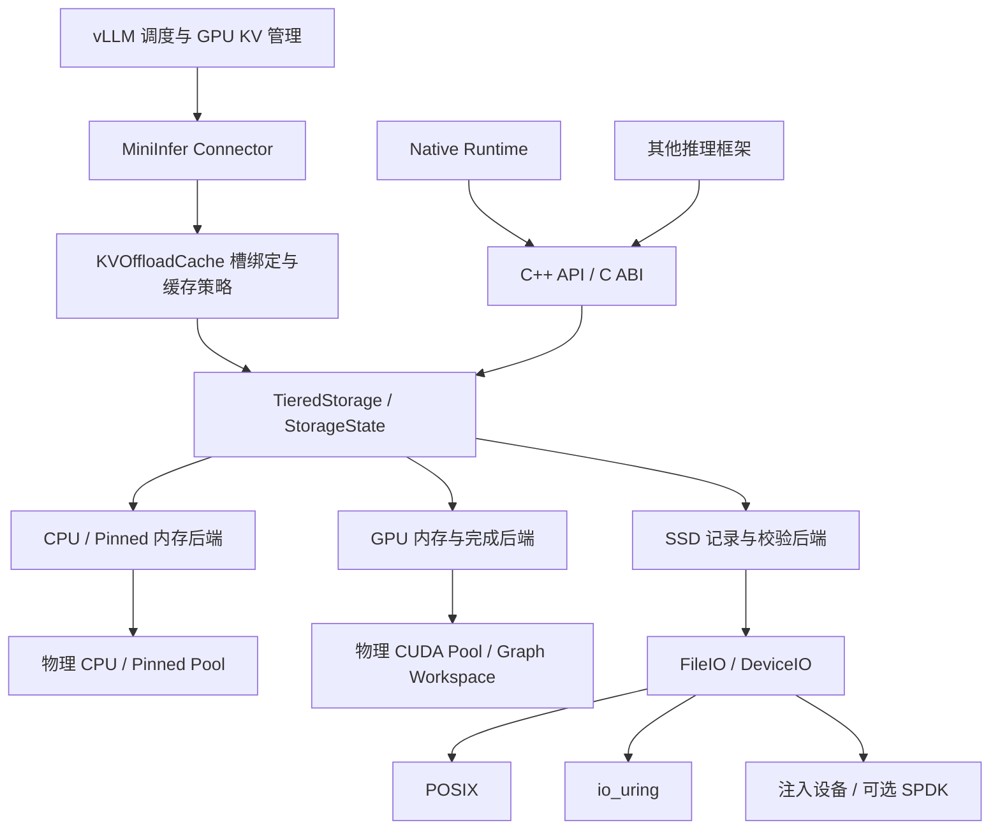

# Infer · MiniInfer Storage Runtime

面向大模型推理的 C++17 / C11 / CUDA 内存与分层 KV Cache 存储工程，同时包含一个可独立运行的原生 Llama 推理框架。

**核心目标：在有限显存下保留和复用 KV 数据，减少旧前缀被回收后的重复计算，并让业务层通过稳定的 Block 接口使用 CPU、Pinned Memory、GPU 和 SSD。**

本仓库包含三个可以组合使用的部分：

| 部分 | 用途 | 入口 |
|---|---|---|
| Storage Runtime | 内存池、逻辑 Block、Lease、CPU/GPU/SSD 迁移、异步 I/O | [`include/infer`](include/infer)、[`src/storage`](src/storage) |
| Native Inference | 自制 Tensor、Llama 模型、CPU/CUDA 算子、Tokenizer、Sampler、生成 CLI | [`include/mini_infer`](include/mini_infer)、[`src/model`](src/model)、[`app`](app) |
| vLLM Integration | 将共享内存池和 CPU/SSD KV 存储接入 vLLM | [`integrations/vllm`](integrations/vllm) |

Native 和 vLLM 接入复用同一套物理资源与存储实现。vLLM 模式的模型计算、请求调度和 GPU KV BlockPool 仍由 vLLM 提供。

> 当前产品源码以 `main` 分支为准，包含构建配置、必要依赖和本文档。测试、Benchmark、性能日志、模型权重、本地备份和编译产物不随本次产品源码发布。C++、C ABI、Native 和 vLLM 接入共用一个逻辑存储核心，统一从根目录构建。

## 导航

- [解决的问题](#解决的问题)
- [能力与当前边界](#能力与当前边界)
- [架构与数据模型](#架构与数据模型)
- [环境要求](#环境要求)
- [快速构建](#快速构建)
- [C++ 使用示例](#c-使用示例)
- [C ABI 与可替换设备](#c-abi-与可替换设备)
- [原生推理](#原生推理)
- [vLLM 接入](#vllm-接入)
- [异步与所有权约定](#异步与所有权约定)
- [构建选项](#构建选项)
- [性能与验证状态](#性能与验证状态)
- [目录与阅读顺序](#目录与阅读顺序)
- [第三方代码与许可证](#第三方代码与许可证)

## 解决的问题

长上下文、多轮对话和并发请求会产生大量 KV Cache。显存容量有限，旧前缀的 KV 被回收后，再次访问可能需要重新计算；同时，把数据搬到主机或 SSD 会引入缓冲所有权、异步完成、版本一致性和资源回收问题。

Infer 将这些职责分开：

- **逻辑数据生命周期**：谁拥有 Block、内容是否有效、版本是多少、当前位于哪里、能否迁移或释放。
- **物理资源生命周期**：CPU 内存和显存怎样分配、复用，CUDA Stream/Event/Graph 何时允许回收资源。
- **数据搬运**：异步文件 I/O、CPU/GPU 拷贝、Pinned 中转、完成等待和失败回滚。
- **框架策略**：哪些前缀值得保留、何时预取、如何选择驻留块，由对应集成和缓存策略表达。

业务调用不需要计算 SSD 文件偏移，也不需要参与内存池分桶。底层实现可通过已有合同注入；数据有效性和实际完成不能因更换后端而改变。

## 能力与当前边界

| 模块 | 已有能力 | 边界 |
|---|---|---|
| CPU Pool | 对齐分配、容量桶、线程本地缓存、跨线程归还、预算、OOM 回收重试 | 与逻辑 KV Block 分开管理 |
| Pinned Pool | 锁页内存分配与复用、DMA staging | 覆盖或释放必须晚于相关 DMA 完成 |
| CUDA Pool | Stream 关联、Event、pending/ready、拆分合并、OOM 恢复 | 跨 Stream 使用需要明确依赖 |
| CUDA Graph | Capture / workspace 生命周期支持 | Graph 引用的地址不能任意迁移或释放 |
| Storage Core | 动态 BlockId、READ/WRITE Lease、版本、预算、同步/异步迁移 | 每个实例管理自己的资源，销毁外壳不能与新调用竞争 |
| KV Offload | 框架槽绑定、CPU 驻留、SSD 下放、LRU、可选热点保护、预取和副本复用 | 不替代推理框架的请求调度或前缀匹配 |
| SSD | 定长物理记录槽、有效长度、身份/版本/CRC32C 校验、私有文件分片 | 临时 spill，不是重启恢复或掉电持久化格式 |
| I/O | POSIX、可选 dlsym / io_uring、可注入字节设备 | 明确请求不可用后端时会返回错误 |
| SPDK | 专用 PCIe NVMe 后端、批量记录写入与设备自有 DMA；官方源码子模块固定提交 | 需要显式构建 SDK、绑定专用盘；已验证本机三星 NVMe 与 CUDA 往返 |
| Native | 单序列 FP32 Llama、MHA/GQA/MQA、CPU/CUDA、三级 Paged KV、前缀共享和采样 | 没有连续批处理或批量 GEMM prefill |
| vLLM | 实验性单 rank connector、批量 DMA、CPU/SSD 分层 | 针对 vLLM 0.31.0 / 0.32.0、一个 FullAttention KV group 验证 |

## 架构与数据模型



### 一份权威逻辑记录

[`LogicalBlockRecord`](src/storage/storage_state.h) 保存逻辑身份、有效大小、内容版本、位置、Lease、当前物理分配，以及正在进行的迁移或待清理资源。

核心目录为 `SlotTable<unique_ptr<LogicalBlockRecord>>`。句柄带 tag 和直接槽索引，复用目录槽不会让旧句柄重新有效；记录地址在目录扩容时保持稳定。

`KVOffloadCache` 使用连续 Entry 数组保存框架槽绑定、LRU 链接、准入/热点/预取状态。Entry 借用核心记录，不另存一套位置、大小和版本。逻辑 BlockId、框架槽号、SSD 物理槽、物理池指针分别承担不同职责，不能相互当作地址使用。

### 迁移是一段明确的资源事务

```text
保护源 + 预留目标预算
        ↓
分配目标资源
        ↓
复制 / I/O / 必要的 Pinned 中转
        ↓
等待实际完成 + 校验目标
        ↓
提交新位置
        ↓
释放或保留旧源；释放成功后归还预算
```

提交前失败保留原有效源。提交后源清理失败会报告 `cleanup_pending`，保留资源记录和预算，允许重试。不能确认 CUDA 完成的资源被隔离，不进入可复用列表。

### SSD 读取路径

文件记录由 64 字节头和载荷组成，校验身份、版本、长度、头 CRC 和载荷 CRC32C。物理槽布局由后端负责，业务不能依赖 `BlockId × stride` 寻址。

POSIX 的逐记录读取按 256 KiB 窗口交错执行读取与 CRC，数据直接进入最终目标地址，使校验尽量复用刚读入的 CPU 缓存；大块批次使用已有的并行 worker。io_uring 的并行批读复用已有 I/O lane，并按约 1 MiB 载荷组织读取/CRC 窗口：小记录继续合批，大记录加入后结束当前窗口，完成后及时校验。

存储层分别描述头和载荷，POSIX FileIO 将相邻文件范围合并为有界 `preadv`，直接写入各自目标；不分配整块拼接缓冲。记录身份、版本和 CRC 仍在存储层校验。

## 环境要求

| 构建内容 | 依赖 |
|---|---|
| CPU Storage Runtime | Linux/WSL2、C/C++17 编译器、pthread、CMake；无需 CUDA Toolkit |
| C ABI | C11 + C++17、CMake **3.24+**；CUDA 可关闭 |
| 独立 C 物理模块 | C11、pthread；关闭逻辑 runtime 后无需 C++ |
| CUDA / Pinned / Graph | NVIDIA GPU、兼容驱动、CUDA Toolkit；ASYNC/POOL 模式要求 Toolkit 11.2+ |
| Native 推理 | CUDA Toolkit / nvcc；CPU 运行模式同样需要构建此后端 |
| vLLM 桥接 | CUDA、所选 Python 环境中的 PyTorch、vLLM **0.31.0 或 0.32.0** |
| io_uring | 可选系统 liburing、允许 io_uring 的 Linux 内核 |
| SPDK | 可选；固定提交的官方源码子模块或外部 SDK、对应 pkg-config 文件和设备配置 |

所有模块统一要求 CMake 3.24+。Ninja 可选。原生 Armadillo 加速可选，未找到时使用标量 CPU 实现。

Ubuntu / WSL 的基础工具可以安装为：

```bash
sudo apt-get update
sudo apt-get install -y build-essential ninja-build pkg-config liburing-dev
cmake --version
```

如果系统 CMake 低于 3.24，在自己的开发环境中安装较新版本。CUDA、PyTorch 和 vLLM 应使用与实际 GPU/驱动兼容的组合。

## 快速构建

推荐使用下面的统一配置入口。后续 CMake 命令保留给需要单独链接库、安装 SDK 或管理编译选项的调用者。

```bash
git clone https://github.com/sahal-colder/MiniInfer.git
cd MiniInfer
```

### 统一配置与启动

修改根目录 [`infer.conf`](infer.conf)，再用 [`app/infer.py`](app/infer.py) 构建和启动。配置方式参考本地 kvstore 的实际 `kvs_config`：`key value`、空行、`#` 注释和引号；不执行变量展开或 shell 表达式。仅需 Python 3.10+ 标准库，配置检查不会导入 PyTorch/vLLM，也不会创建缓存或构建目录。

```text
framework native
cuda yes
device cuda
memory-mode pool
model /path/to/model.bin
tokenizer /path/to/tokenizer.bin
prompt "Explain KV cache"
max-tokens 64
```

```bash
python3 app/infer.py --check-config
python3 app/infer.py --print-config
python3 app/infer.py build
python3 app/infer.py run
```

改用 vLLM 时，在同一个文件中设置 `framework vllm`，将 `model` 改为 Hugging Face 模型目录或 ID，`tokenizer ""` 使用模型自带 Tokenizer。`storage-engine` 可选 `posix`、`uring`、`auto` 或 `spdk`；CPU/SSD 预算和 I/O 并发也在此文件配置。vLLM/PyTorch 安装在运行该脚本的同一个 Python 环境中；桥接编译自动使用这个解释器。

配置优先级为 **默认值 → 配置文件 → `--key value`**，CLI 参数位置不影响覆盖顺序。所有配置项均可直接覆盖；自定义文件使用 `--config /path/to/infer.conf`，相对文件路径以该配置文件所在目录为基准。比如临时切换框架、预览命令：

```bash
python3 app/infer.py build --framework vllm --storage-engine uring
python3 app/infer.py run --framework vllm --storage-engine uring \
  --model /path/to/huggingface-model --tokenizer "" --dry-run
```

`--print-config` 输出生效配置的 JSON，供检查使用。`--dry-run` 只输出配置产生的构建命令或启动参数，不编译、不下载模型、不初始化 GPU。`framework storage` 只构建存储库，配合 `cuda no` 可构建 CPU 产品；库调用仍使用 C/C++ API。直接使用 CMake 时不会读取 `infer.conf`。

配置只在构建、启动阶段读取，不进入分配、I/O 或推理热路径。改变框架、CUDA 能力、内存模式或增加后端后先重新执行 `build`；启动时会核对已有构建配置，显式后端不可用会报错。vLLM 入口会用配置中的值组装现有 connector，不再受继承的 `MINIINFER_*` 环境变量影响；直接使用原 connector 的环境变量接口仍保留。

`storage-engine`、SSD 配置和 CPU/SSD 预算同时传入 Native 分页 KV 与 vLLM 接入。Native 的 `gpu-cache-bytes` 为 0 时按模型几何自动计算 GPU KV 预算；直接使用 C++ 时仍由 `ModelOptions::paged` 配置。DMA 窗口和 vLLM 模型执行预算保持 vLLM 专属。显式 KV checkpoint 继续通过 `KVCacheStorage` API 使用。`memory-mode` 选择 MiniInfer 自身 CUDA 分配器的实现。

Native 使用 SPDK 时，配置经 CLI 传入 `LlamaModel` 和分页缓存，实际设备 I/O 计数在退出时报告。GPU/SSD 换页优先复用 SPDK 自有、CUDA 注册的两个主机 DMA 槽，省去一层载荷拷贝；旧 DMA 预算不足时保留原有有界缓冲路径。该路径仍使用主机内存。真正 GPUDirect Storage 依赖 GPU、驱动及文件系统支持；本机 RTX 4060 Laptop 的 `gdscheck` 报告 `GDR=unsupported`，不具备已验证的 GDS P2P 路径。`cufile yes` 仅启用已有可选权重后端，Native 权重加载的 io_uring 路径独立于 KV 使用的 SPDK 后端。

统一配置的 `ssd-bytes` 是物理记录预算。connector 在模型 KV 布局确定后扣除每槽的容量取整、64 字节头部及设备对齐，再计算逻辑槽数；SPDK 区域不会被载荷预算超配。Pinned DMA 窗口与操作系统文件页缓存不包含在这个 SSD 数字中。直接使用旧 connector 的 `disk_capacity_bytes` 载荷合同保持不变；新的物理预算通过 `miniinfer_ssd_bytes` 明确传入。

普通构建使用 CMake 3.24+、Ninja 和配置中指定的 `jobs`；如果 CMake 不在默认 PATH，可以设置 `cmake /absolute/path/to/cmake`。SPDK 的源码初始化和 SDK 构建要求见后文。

### 1. 构建 CPU 存储库

```bash
cmake -S . -B build-cpu -G Ninja \
  -DCMAKE_BUILD_TYPE=Release \
  -DINFER_ENABLE_CUDA=OFF \
  -DINFER_BUILD_NATIVE=OFF \
  -DINFER_BUILD_VLLM=OFF
cmake --build build-cpu --parallel 6
```

得到 `infer_memory`、`infer_storage` 静态库，以及默认启用的 C ABI 和 preload 库。只需 C++ 库时，可关闭 `INFER_BUILD_C_API` 和 `INFER_BUILD_PRELOAD`。CPU-only 构建不会要求 CUDA SDK，不能使用 GPU/Pinned 分配功能。

### 2. 启用 CUDA 存储库

```bash
cmake -S . -B build-cuda -G Ninja \
  -DCMAKE_BUILD_TYPE=Release \
  -DINFER_ENABLE_CUDA=ON \
  -DINFER_BUILD_NATIVE=OFF \
  -DINFER_BUILD_VLLM=OFF
cmake --build build-cuda --parallel 6
```

这一配置只构建共享基础设施，不构建 Native 推理算子。若构建需要 nvcc 的后端，可通过 `CMAKE_CUDA_COMPILER` 和 `CMAKE_CUDA_ARCHITECTURES` 指定 Toolkit 与目标架构。

### 3. 构建 C ABI

```bash
cmake -S . -B build-capi -G Ninja \
  -DCMAKE_BUILD_TYPE=Release \
  -DINFER_ENABLE_CUDA=OFF \
  -DINFER_BUILD_C_API=ON
cmake --build build-capi --parallel 6
```

生成 `libinfer.so.3`，以及启用时的 `libinfer_preload.so`。公开 ABI 为 **3**；ABI 2 的二进制调用者需要重新编译。

只构建 C 物理模块及适配器：

```bash
cmake -S . -B build-physical -G Ninja \
  -DINFER_ENABLE_CUDA=OFF \
  -DINFER_BUILD_RUNTIME=OFF \
  -DINFER_BUILD_PRELOAD=OFF
cmake --build build-physical --parallel 6
```

产品快照不包含测试、示例或 Benchmark 目录，相关构建开关默认关闭，不应在此源码包中开启。

## C++ 使用示例

下面是一个完整的 CPU 写入、异步下放 SSD、校验读回示例。调用方只使用逻辑 BlockId，不操作文件偏移。

```cpp
#include <infer/storage/tiered_storage.h>
#include <cstring>
#include <exception>
#include <iostream>
#include <stdexcept>

int main() {
    infer::StorageConfig config;
    config.block_bytes = 4096;
    config.budget.cpu_bytes = 8192;
    config.budget.ssd_bytes = 8 * 1024 * 1024;
    config.ssd_directory = "/tmp";
    infer::TieredStorage storage(config);

    const char payload[] = "hello from MiniInfer";
    const auto id = storage.create(sizeof(payload));
    {
        auto lease = storage.acquire(id, infer::AccessMode::WRITE);
        std::memcpy(lease.writable_data(), payload, sizeof(payload));
        lease.finish();
    }

    auto migration = storage.migrate_async(id, infer::StorageLocation::SSD);
    const auto result = migration.get();
    if (result.error)
        std::rethrow_exception(result.error);
    if (!result.committed || result.cleanup_pending)
        throw std::runtime_error("Migration did not complete cleanly");

    char restored[sizeof(payload)]{};
    storage.read_to_host(id, restored, sizeof(restored));
    if (std::memcmp(payload, restored, sizeof(payload)) != 0)
        throw std::runtime_error("Restored content mismatch");
    std::cout << restored << '\n';
    if (!storage.erase(id))
        throw std::runtime_error("Block is still in use");
}
```

### 安装并供外部项目链接

```bash
cmake --install build-cpu --prefix "$PWD/install-cpu"
```

将上例保存为外部项目的 `main.cpp`，使用：

```cmake
cmake_minimum_required(VERSION 3.18)
project(StorageExample LANGUAGES CXX)
find_package(Infer CONFIG REQUIRED)
add_executable(storage_example main.cpp)
target_link_libraries(storage_example PRIVATE Infer::storage)
```

配置外部项目时传入 `-DCMAKE_PREFIX_PATH=/absolute/path/to/install-cpu`。公开目标包括 `Infer::memory`、`Infer::io`、`Infer::storage`；启用 Native 时，`Infer::native_compute` 提供模型、算子和生成能力，链接物理内存、文件 I/O 与分页 KV 所需的逻辑存储核心；`Infer::native` 保留包含 checkpoint 存储适配和 CLI 支持的聚合入口。兼容的 `MiniInfer::*` 目标继续保留。

## C ABI 与可替换设备

C 头文件不暴露 CUDA、liburing 或 SPDK 结构体，业务通过 opaque handle 操作资源：

| 接口 | 职责 |
|---|---|
| `if_runtime_allocate / release` | 创建和释放动态逻辑 Block |
| `if_runtime_write / read` | 使用主机缓冲写入和读取 |
| `if_runtime_acquire` | 请求 CPU/GPU 访问；必要时迁移，返回 Lease |
| `if_lease_finish / destroy` | 完成访问、提交 WRITE、销毁访问句柄 |
| `if_runtime_migrate_async` | 提交有界异步迁移 |
| `if_migration_poll / wait` | 查询或等待真正完成的迁移结果 |
| `if_runtime_retry_cleanup` | 重试迁移遗留资源清理 |
| `if_store_*` | 框架固定槽兼容入口，复用同一逻辑核心 |
| `if_aio_*` | 有界异步存储作业 |
| `if_pool_*` | 可独立使用的 C 物理内存池 |

成功通常返回 0，读取返回长度；失败采用 `-errno`。`if_migration_poll` 返回 1 表示未完成。迁移结果中的 `committed`、`cleanup_pending` 和 `error` 必须一起处理。C++ 异常不会越过 C ABI。

`allocate` 后内容尚未初始化，完整 `write` 或成功 WRITE Lease `finish` 后才能读取。READ Lease 可共享，WRITE 独占；持有 Lease 时不能迁移或释放同一块。

初始化时通过 `if_upstream` 注入内存上游，通过 `if_dev_ops` / `if_dev` 注入字节设备。现有 POSIX、RTLD_NEXT dlsym、io_uring 实现可以独立选择；业务 allocate/read/write 不变。C++ 调用者也可以通过现有 allocator / StorageBackend 合同注入资源。

```bash
cmake --install build-capi --prefix "$PWD/install-capi"
```

C 头安装在 `include/miniinfer/infer/`，避免与 C++ 的 `infer/infer.h` 冲突。C 程序包含 `<infer/runtime.h>` 时，编译增加 `-I<install>/include/miniinfer`，链接 `-L<install>/lib -linfer`，并配置运行期库搜索路径。使用 CMake 时链接 `Infer::c_api` 会自动提供头文件路径；独立 C 物理模块可链接 `Infer::c_memory` 和 `Infer::device_io`。

`INFER_IO_DLSYM`、`INFER_IO_URING` 控制 C DeviceIO 模块；`INFER_ENABLE_IO_URING` 控制 C++ 文件后端。两个 I/O 模块使用独立开关；关闭其中一个不代表关闭所有 liburing 使用。

`LD_PRELOAD` 分配垫片为可选 glibc 模块；动态符号解析只发生在适配边界，包含一次初始化和递归 bootstrap。它不是业务使用 Storage Runtime 的前提，也不支持在仍有存活分配时热卸载。

## 原生推理

Native 后端包含 Tensor、CUDA 三级 Paged KV / CPU 连续 KV Cache、权重加载、Attention/QKV、MLP、RoPE、Embedding、Softmax、GEMV、Tokenizer、Sampler 和 CLI。

```bash
cmake -S . -B build-native -G Ninja \
  -DCMAKE_BUILD_TYPE=Release \
  -DINFER_ENABLE_CUDA=ON \
  -DINFER_BUILD_NATIVE=ON \
  -DINFER_BUILD_VLLM=OFF \
  -DCMAKE_CUDA_ARCHITECTURES=native
cmake --build build-native --parallel 6
./build-native/mini_infer_main --help
```

`native` 架构检测需要 CMake 3.24+ 和可见 GPU。交叉编译或没有可见 GPU 时，按目标硬件改为 Toolkit 支持的明确架构值。

模型权重和 Tokenizer 由使用者提供：

```bash
./build-native/mini_infer_main \
  --model /path/to/model.bin \
  --tokenizer /path/to/tokenizer.bin \
  --device cpu \
  --prompt "Once upon a time" \
  --steps 64
```

切换 `--device cuda` 使用 GPU。支持 greedy、temperature、top-k 采样；全部参数以 `--help` 为准。

**当前 Native 模型格式：** `llama2.c` legacy FP32 checkpoint（28 字节头）与匹配的 `tokenizer.bin`。CUDA 路径额外支持带 MiniInfer 配置元数据的具名 FP32 `.safetensors`：通过 io_uring＋O_DIRECT＋固定双槽 Pinned 缓冲加载，SDK 可选 cuFile。格式和完整核心实现见 本机开发文档 `docs/storage-memory-subsystem.md`（不随产品源码发布）。不直接读取 GGUF、任意 Hugging Face 模型或完整量化 checkpoint；独立 INT8 分组 GEMV 算子不等于完整 INT8 模型支持。

CUDA `LlamaModel` 默认使用不连续分页 Attention、完整页前缀共享与按层预取；CPU 保留连续 KV。通过 `ModelOptions` 可设置三级预算或显式选择旧连续路径。接入与独立端到端 Benchmark 见 本机开发文档 `docs/paged-model-integration.md`（不随产品源码发布）。

一个 `LlamaModel` 维护一条序列，不能并发调用。`prefill(tokens)` 和 `forward(token)` 推进同一 KV 状态；prefill 当前仍逐 token 执行 decoder，没有批量 GEMM prefill 或多请求调度。

模型在主机一次校验整批 token 后，首层直接借用对应的只读 embedding 权重行，结果写入独立工作区；不上传 token 再读回校验，也不复制 embedding 行。最终 logits 仍同步回传 CPU，供现有采样接口使用。独立的 Embedding 算子保留其原有输入验证合同。

### 共享池与 KV checkpoint

`infer::native::AllocatorAdapter` 将共享分配器接入原生 Tensor/模型；`infer::native::KVCacheStorage` 将各层有效 K/V 保存到共享 CPU/SSD 存储。

Checkpoint 按最多 256-token 等量的页组织，尾页仅保存有效字节；恢复先校验暂存数据，再更新目标。它是显式 save/restore，不自动把连续 Attention KV 改为分页布局，也不负责模型 position 或调度状态恢复。恢复暂存与有效载荷总量相关，不能当作固定额外内存大小的流式恢复。

## vLLM 接入

此集成为实验性单 rank 接入，支持 vLLM 0.31.0 与 0.32.0；其他版本需要重新验证其内部接口和布局。模型、请求调度、前缀匹配仍由 vLLM 提供。

先准备兼容的 PyTorch / CUDA Python 环境，再安装对应版本并编译桥接库：

```bash
python3 -m pip install 'vllm==0.31.0'
cmake -S . -B build-vllm -G Ninja \
  -DCMAKE_BUILD_TYPE=Release \
  -DINFER_ENABLE_CUDA=ON \
  -DINFER_BUILD_NATIVE=OFF \
  -DINFER_BUILD_VLLM=ON \
  -DPython3_EXECUTABLE="$(command -v python3)"
cmake --build build-vllm --parallel 6

export PYTHONPATH="$PWD/integrations/vllm${PYTHONPATH:+:$PYTHONPATH}"
export MINIINFER_BRIDGE="$PWD/build-vllm/libminiinfer_vllm_bridge.so"
export MINIINFER_POOL_BRIDGE="$PWD/build-vllm/libminiinfer_pool_bridge.so"
```

下面给出 CPU/SSD 分层 connector 的配置形式。`model` 可以是本地 Hugging Face 模型目录；硬件、模型和显存预算需匹配。

```python
from pathlib import Path
from vllm import LLM, SamplingParams

cache = Path("/tmp/miniinfer-kv")
cache.mkdir(parents=True, exist_ok=True)

llm = LLM(
    model="/path/to/huggingface-model",
    enable_prefix_caching=True,
    kv_transfer_config={
        "kv_connector": "MiniInferTieredConnector",
        "kv_connector_module_path": "tiered_connector",
        "kv_role": "kv_both",
        "kv_connector_extra_config": {
            "lazy_offload": False,
            "kv_offload_backend": "disk",
            "use_page_cache": True,
            "disk_path": str(cache / "kv.cache"),
            "cpu_bytes_to_use": 32 << 30,
            "disk_capacity_bytes": 32 << 30,
            "miniinfer_cpu_bytes": 256 << 20,
            "disk_buffer_slots": 64,
            "miniinfer_min_reuse": 1,
        },
    },
)
outputs = llm.generate(
    ["Explain why a KV cache helps language-model inference."],
    SamplingParams(temperature=0, max_tokens=32),
)
print(outputs[0].outputs[0].text)
```

在 disk 模式下，`cpu_bytes_to_use` 是上游调度槽命名所使用的容量参数；实际 MiniInfer CPU 驻留预算由 `miniinfer_cpu_bytes` 决定。SSD 记录头和物理容量取整也占空间。`disk_buffer_slots=64` 对应每方向两个 32-block DMA 窗口；两个方向的 Pinned 开销约为 `2 × disk_buffer_slots × payload_bytes`，不是免费的额外缓存。

这段配置只启用分层 connector。若还要让 GPU KV Tensor backing 和 Pinned 分配经过共享物理池，在创建 LLM 前使用 [`pool_runtime.Pools`](integrations/vllm/pool_runtime.py) 与 [`pool_adapter.install`](integrations/vllm/pool_adapter.py)；这会影响进程内分配入口，应按部署方式显式选择。

### 常用后端配置

| 环境变量 | 可选值 / 作用 |
|---|---|
| `MINIINFER_FILE_IO` | `posix` / `uring` / `auto` / `direct`（固定缓冲 io_uring + O_DIRECT） |
| `MINIINFER_IO_DEPTH` | 1–64，ring 的配置上限 |
| `MINIINFER_FILE_SHARDS` | 1 或 4 个私有文件分片 |
| `MINIINFER_SSD_VERIFY` | `none` / `read_back` / `on_read`；Release 默认 `none`，另两种模式保留 CRC |
| `MINIINFER_WRITE_CONCURRENCY` | 有界 CPU→SSD 下放并发 |
| `MINIINFER_COMPACT_SLOTS` | `1` 使用更细的物理容量取整 |
| `MINIINFER_CPU_HOT` | `1` 启用可选 CPU 热块保护 |
| `MINIINFER_PROFILE_TRANSFERS` | `1` 开启可选传输观测，存在计时开销 |

显式 `uring` 使用真实 io_uring；`auto` 优先尝试可用 ring，不能理解成根据运行负载自动选择最快实现。当前文件 connector 要求 buffered I/O；不将原生 vLLM 的 O_DIRECT 结果和 buffered 结果混为相同缓存条件。

MiniInfer 后端独立管理读写队列和缓冲生命周期，通过 `launch_copy` / 完成事件接入 vLLM，复用其 DMA 原语；不继承上游磁盘后端的文件和缓冲状态。文件布局、校验与预算继续由共享存储核心管理。

两个 Pinned 半区分别保留跨请求的 DMA 事件，覆盖缓冲前等待对应事件。正常加载在提交 DMA 后发布完成事件，消费者等待该事件后才可使用 GPU 数据；不在发布前重复同步整个 stream。首批读取和单窗口写入在现有后台线程直接执行，后续预读及多窗口写入仍通过原生队列重叠执行。失败、抢占、显式 drain 和关停继续排空文件任务与 GPU 工作。

## 异步与所有权约定

- **Lease**：资源访问凭证，不能把裸地址缓存到 Lease 结束之后。WRITE 需要显式完成提交，放弃写入会使内容不可读。
- **GPU consumer stream**：C++ acquire 使用明确 stream；C ABI 提供后端拥有的 stream，可通过 `if_lease_stream` 获取。其他 stream 的使用需要建立依赖，不会被自动追踪。
- **异步缓冲**：源、目标和 fd 必须活到同步返回或相应异步完成；submit 成功不等于数据已可消费。
- **关闭**：destroy 不得与同一外壳的新调用并发。已接受迁移会排空；Lease 可以保活核心状态。AIO 借用 store 时，过早销毁 store 返回忙。
- **清理失败**：检查显式 finish/destroy 和迁移结果。需要重试时保留句柄；不能将“新位置已提交但旧源未清理”当作完全未发生迁移。
- **Graph**：捕获的地址必须保持到所有相关 Graph/GraphExec 引用释放。物理池的 Graph 生命周期与逻辑缓存淘汰分开。
- **预算**：逻辑驻留、迁移预留、副本和待清理容量都计费；物理池统计与逻辑预算分别观察，外部注入 allocator 的额外缓存也要单独核算。

## 构建选项

产品构建和启动优先修改 [`infer.conf`](infer.conf)。下表为高级调用者直接使用的 CMake 开关；[`include/infer/config.h`](include/infer/config.h) 保留 C++ 宏与兼容默认值，生成头文件记录实际编译能力。安装包会导出本次构建的宏配置，不能只修改消费者宏来切换已经编译的库。

| 根工程选项 | 默认 | 含义 |
|---|---|---|
| `INFER_ENABLE_CUDA` | ON | CUDA / Pinned 及 GPU Storage |
| `INFER_BUILD_NATIVE` | config.h 默认 ON；CPU-only 默认 OFF | Native 推理和 CLI |
| `INFER_BUILD_VLLM` | config.h 默认 OFF | vLLM C++ bridges |
| `INFER_MEMORY_MODE` | 2 | 0 同步、1 CUDA async、2 缓存池 |
| `INFER_ENABLE_IO_URING` | ON，依赖可选 | C++ 文件 I/O |
| `INFER_ENABLE_SPDK` | OFF | 启用 SPDK SDK 后端 |
| `INFER_SPDK_URING` | OFF | 额外链接 SPDK uring bdev，仅用于显式选择该 bdev；原生 NVMe 不需要 |
| `INFER_SPDK_ROOT` | 空 | SPDK 源码构建树或已安装 SDK 前缀 |
| `INFER_BUILD_RUNTIME` | ON | 共享 C++ 逻辑存储核心 |
| `INFER_BUILD_C_API` | ON | C ABI 与独立 C 物理模块 |
| `INFER_BUILD_PRELOAD` | ON | glibc LD_PRELOAD 分配器 |
| `MINI_INFER_USE_ARMADILLO` | ON，仅 Native | 可选 CPU 加速 |

| C 物理模块选项（同一根工程） | 默认 | 含义 |
|---|---|---|
| `INFER_IO_DLSYM` | ON | RTLD_NEXT 文件适配器 |
| `INFER_IO_URING` | ON，依赖可选 | C DeviceIO 的 io_uring 实现 |

SPDK 官方源码通过 [`third_party/spdk`](third_party/spdk) 子模块固定到 `v26.09` 的提交 `0bbb7fe4dccfb31e8d446da8822360704949d1e9`，许可证随上游源码保留。普通 CPU、CUDA、C ABI 构建不要求初始化 SPDK，CMake 也不会隐式下载或编译它。

SPDK 的部署目标是在 Linux 上独占一块专用 NVMe。原生 NVMe bdev 通过用户态驱动访问 PCIe 控制器，不经过 io_uring；SPDK uring bdev 则走内核 I/O，是另一条可选路径。独立的 `storage-engine uring` 不要求 SPDK。三者按实际 KV 负载比较，不因组合了更多组件就默认更快。

需要 SPDK 时，先初始化源码及所需依赖，按照[固定版本的官方构建说明](https://github.com/spdk/spdk/blob/0bbb7fe4dccfb31e8d446da8822360704949d1e9/README.md#prerequisites)安装系统依赖，再显式构建 SDK。原生 NVMe 不要求 liburing：

```bash
git submodule update --init third_party/spdk
git -C third_party/spdk submodule update --init dpdk isa-l isa-l-crypto
cd third_party/spdk
./configure --without-uring --disable-tests --disable-unit-tests \
  --disable-examples --disable-apps
make -j"$(nproc)"
cd ../..

cmake -S . -B build-spdk -G Ninja \
  -DCMAKE_BUILD_TYPE=Release \
  -DINFER_ENABLE_CUDA=OFF \
  -DINFER_ENABLE_SPDK=ON \
  -DINFER_SPDK_ROOT="$PWD/third_party/spdk"
cmake --build build-spdk -j"$(nproc)"
```

也可将 `INFER_SPDK_ROOT` 指向外部 SDK，或通过 `PKG_CONFIG_PATH` 提供已安装的 SDK。接口见 [`ssd_device.h`](include/infer/storage/ssd_device.h)。选择 bdev、JSON 配置、PCI 绑定及 hugepage 配置由部署方明确指定；构建不会接管系统设备。源码目录、编译生成的 SDK 与真正可用的 NVMe 设备是三个不同条件。

### 专用 NVMe 配置

将目标控制器的 PCI 地址填入下列 JSON（`0000:01:00.0` 仅为占位示例），保存为 `nvme.json`。在 Linux 上按 SPDK 部署要求为该控制器准备 VFIO/IOMMU 和 hugepages；同一个控制器不能同时由 SPDK 和内核 NVMe 驱动拥有。明确选择空闲的专用盘，绑定粒度是控制器，包含其所有 namespace。

```json
{
  "subsystems": [
    {"subsystem": "iobuf", "config": [
      {"method": "iobuf_set_options", "params": {"small_pool_count": 512, "large_pool_count": 64}}
    ]},
    {"subsystem": "bdev", "config": [
      {"method": "bdev_set_options", "params": {"bdev_io_pool_size": 1024, "bdev_io_cache_size": 64}},
      {"method": "bdev_nvme_attach_controller", "params": {"name": "MiniInferNvme", "trtype": "PCIe", "traddr": "0000:01:00.0"}}
    ]}
  ]
}
```

在 `infer.conf` 中配置该 SDK、JSON 和 namespace 的 bdev 名称：

```text
storage-engine spdk
spdk-sdk /path/to/spdk
spdk-config /path/to/nvme.json
spdk-bdev MiniInferNvmen1
spdk-no-huge no
spdk-no-pci no
spdk-reactor-mask 0x1
spdk-iova-mode auto
```

`MiniInferNvmen1` 假定目标为 namespace 1，应按设备实际名称填写。`ssd-bytes` 必须不超过所选 namespace 的可用容量；这片区域是 MiniInfer 临时 KV 存储，会覆盖原内容。reactor 的 CPU mask 应按 NVMe/GPU 的 NUMA 拓扑与模型 CPU 线程分配；示例的核 0 不代表最快选择。`io-depth` 和 `spdk-chunk-kib` 控制并发及 DMA 窗口，应以实机测试确定。PCI 和 hugepages 现为 SPDK 默认设置；malloc/文件测试需显式设置 `spdk-no-huge yes`、`spdk-no-pci yes`。

`spdk-iova-mode` 可选 `auto`、`va`、`pa`，默认保留 SPDK 的自动选择。普通用户通过 VFIO/IOMMU 运行时可显式选择 `va`；该模式使用 64 GiB 的地址起点提示，以适配本机有限宽度的 IOMMU 并避开 CUDA 的低地址映射。VFIO 设备及 hugetlbfs 挂载目录需要授予运行用户访问权限，大页数量和 memlock 必须覆盖 EAL 预算。显式 `spdk-sdk` 优先于继承的 `PKG_CONFIG_PATH`，重新配置已有构建时也会重新解析 SDK。

vLLM 磁盘连接器在 CUDA 12.8+ 的构建中默认使用原生传输执行器：每个请求通过一次 C ABI 调用完成窗口划分、DMA 描述符提交和存储 I/O，仍由连接器发布独立的完成事件。`MINIINFER_NATIVE_TRANSFERS=0` 可选择 Python 路径；开启传输分段计时或关闭 DMA 描述符复用时继续使用该路径。旧 bridge 不提供原生执行器时自动保持原有行为。

显式配置 SPDK 后，普通磁盘和 CPU/SSD 分层连接器均使用设备分配、CUDA 注册的 staging 缓冲区。缓冲区与 I/O bounce 槽共享 `spdk-mem-mib` 的固定 EAL 内存预算；配置总 host 预算时只计入一次 EAL，CPU KV 使用剩余额度。EAL 还包含 bdev/mempool，过小的预算会明确失败。只对设备拥有且对齐的范围执行直接 DMA，普通或非对齐指针保留 bounce/RMW。`ssd_direct_*`、`ssd_copied_*` 和 `ssd_dma_reserved_bytes` 统计实际数据路径及存活分配。

设备对齐的记录使用版本 2：把原先已计费的尾部填充移至 64 字节头部之后，使 payload 对齐到设备边界，不增加槽位容量。文件和紧凑设备记录保持版本 1；两者均保留身份、长度、版本和 CRC 校验。该缓存仍无重启恢复合同。Tensor 别名持有底层 DMA 分配，最后一个别名等待 CUDA 消费完成后才解除注册并释放。当前固定版本的 SPDK/DPDK 每进程支持一次完整 app 生命周期；全部设备和别名关闭后，重新创建 SPDK store 需要新进程，以避免 EAL 主线程绑定失效。

如需比较 SPDK uring bdev，单独用 `--with-uring` 构建 SDK（要求 liburing 2.3+），配置 MiniInfer 时显式加 `-DINFER_SPDK_URING=ON`，并在 JSON 中创建对应 bdev。这不改变 `storage-engine uring` 的独立实现。最终选型要在同一物理 NVMe 上顺序测试，固定数据量、CRC/完成语义、CPU/内存预算和缓存条件，覆盖稳态读写及混合负载、P50/P99 和实际推理 TTFT/TPOT/吞吐。当前独立文件路径使用 buffered I/O；裸盘/O_DIRECT 对照仍需接入验证。WSL、malloc bdev 或热页缓存的结果不能决定物理 NVMe 的胜者。

## 性能与验证状态

以下为开发工作区中 2026-10-31 / 2026-11-01 的本机记录，不是所有硬件上的保证。环境为 WSL2、RTX 5060 Ti、GCC 11.4、CUDA Toolkit 12.8、PyTorch 2.13.0+cu130、vLLM 0.31.0。

1792 KiB 载荷、batch 8、128 块，同一文件读取入口，真正完成并核对数据：

| 文件场景 | 优化前 | 当前实现 | 变化 |
|---|---:|---:|---:|
| 热 buffered 读取 | 11.302 GiB/s | 13.308 GiB/s | +17.8% |
| 私有文件 fdatasync/DONTNEED 后读取 | 4.822 GiB/s | 5.916 GiB/s | +22.7% |

DONTNEED 不能驱逐 Windows/VHD/设备缓存，因此第二行不代表物理冷 NVMe 带宽。相同本机负载的 vLLM filesystem buffered 读取约 12.427 GiB/s，但文件布局、线程和发布合同不同，不能当作相同内核实现的直接倍率。

实际 Qwen3-1.7B / BF16 / CUDA Graph 模型回访的交付版两对结果为 **338→316 ms** 和 **318→321 ms**，不足以声称稳定端到端提速。双方都使用 vLLM 的模型计算；不能把文件层提高 17.8% 描述成推理 tokens/s 同幅提高。

开发工作区最终回归记录：CUDA 核心 26/26、C ABI CUDA 11/11、CPU 核心 ASan/UBSan 10/10；vLLM 全套 114 项和 4 个 subtest 通过，包含真实模型。Native 存储集成、独立 C 模块等也做过独立验证。上述测试、原始样本和基准工具按本次发布范围保留在本地，不在这个产品源码快照内，不能直接在此快照运行相应套件。

2026-11-03 补充完成 Linux / RTX 4060 Laptop / 三星 512GB NVMe 的 SPDK 实机验证：固定版本 SDK、普通用户 VFIO、大页、设备记录校验及 CUDA 多层乱序块往返均通过，载荷统计确认使用设备自有直接 DMA。CUDA 批量传输同时适配 12.8 与 13.x 的接口签名；本轮实际使用 CUDA 13.4 构建和验证。

尚未完成的验证包括多 GPU、整盘冷设备稳态、生产在线 P99 和长期运行。TSan 在先前环境遇到启动映射错误，没有竞态检测通过结论。Native 与 vLLM 的完整模型兼容范围也不同，不能把一个框架的通过结果推广到另一个。

## 目录与阅读顺序

```text
MiniInfer/
├── CMakeLists.txt             # 所有产品模块的唯一构建入口
├── infer.conf                # 框架、引擎、模型与预算的统一用户配置
├── cmake/                    # 依赖、安装包、Native 构建
├── app/                      # 统一配置启动器与原生生成 CLI
├── include/
│   ├── infer/                # 内存池、Storage、Native 适配 API
│   ├── c/infer/              # C 公开头（保留原包含和安装路径）
│   └── mini_infer/           # 原生推理框架 API
├── src/
│   ├── core/ cpu/ cuda/      # 共享物理资源
│   ├── c_api/                # 共享 Core 的 C ABI、固定槽兼容和 AIO
│   ├── io/ preload/          # C 设备 I/O 与独立分配垫片
│   ├── storage/              # Block、Lease、迁移、KV 策略、SSD
│   └── base/ tensor/ ops/
│       model/ loader/
│       tokenizer/ sampler/
│       runtime/              # 原生推理实现
├── integrations/
│   ├── native/               # 原生 KV checkpoint
│   └── vllm/                 # connector、桥接、DMA 与策略
└── third_party/
    ├── crc32c/               # 必要 CRC32C 源码与许可证
    └── spdk/                 # 固定提交的官方源码子模块（按需初始化）
```

建议按下面顺序阅读产品代码：

1. [`tiered_storage.h`](include/infer/storage/tiered_storage.h)：业务能力与错误/完成合同。
2. [`storage_state.h`](src/storage/storage_state.h)：唯一权威逻辑记录、所有权与预算。
3. [`transfer.cpp`](src/storage/transfer.cpp)：准备、提交、完成、回滚和清理。
4. [`kv_offload_cache.cpp`](src/storage/kv_offload_cache.cpp)：框架槽绑定与缓存策略。
5. [`ssd_storage.cpp`](src/storage/ssd_storage.cpp) / [`file_io.cpp`](src/storage/file_io.cpp)：记录布局、校验和定位 I/O。
6. [`runtime.h`](include/c/infer/runtime.h)：动态 Block 的 C ABI。
7. [`tiered_connector.py`](integrations/vllm/tiered_connector.py)：vLLM CPU/SSD 接入。
8. [`mini_infer_model.h`](include/mini_infer/model/mini_infer_model.h)：原生推理模型入口。

## 第三方代码与许可证

- CRC32C 的源代码、版权说明和 BSD-style 许可证保留在 [`third_party/crc32c`](third_party/crc32c)。
- vLLM connector 复用或改编部分 vLLM 传输逻辑，说明和 Apache-2.0 文本保留于 [`NOTICE`](integrations/vllm/NOTICE) 与 [`VLLM-LICENSE`](integrations/vllm/VLLM-LICENSE)。安装的 vLLM 源文件不会被修改。
- CUDA、PyTorch、vLLM、可选 Armadillo、liburing、SPDK 等依赖仍遵循各自许可证。

本仓库尚未声明覆盖全部自有代码的统一根许可证；不要将第三方许可证自动理解为整个项目的许可证。

### Kernel direct-file storage

`MINIINFER_FILE_IO=direct MINIINFER_SSD_VERIFY=none` selects the preallocated filesystem backend without SPDK. It initializes written extents outside measured I/O, uses per-worker registered files, optional fixed buffers and batched CQE harvesting. SQPOLL and filesystem IOPOLL are probed independently with interrupt-mode fallback. The concrete `infer::io::DirectFile` API accepts fixed buffer ranges for direct I/O. It tries to raise the process memlock limit; when registration is unavailable, aligned requests use ordinary READ/WRITE SQEs on the original pointer with a fixed file, with no bounce copies. The owned pool is reserved for unaligned metadata/RMW. Batches keep one SQE per block, while singleton ranges have a configurable stripe size (default 4 MiB). Buffers passed in `DirectFileConfig::buffers` must outlive the device. If the full table cannot fit, declared singleton buffers reuse one fixed window of at most 4 MiB per worker. `uring_buffer_window_registrations` reports window replacements: changing windows still incurs registration/pinning work; a repeated window reuses its binding. Allow headroom beyond payload size for kernel page accounting. Temporary buffers without the declared lifetime continue using ordinary direct I/O. HugeTLB is attempted first; the 2 MiB aligned THP fallback is a hint, not guaranteed physical huge pages.

Each worker owns its ring and pool until device destruction. Account for per-worker locked memory and repeated registrations of borrowed buffers. `uring_setup_flags`, `uring_registered_buffer_bytes`, `uring_hugetlb_pools` and copied/direct byte counters expose the actual mode. No fsync or power-loss durability is implied. Local verification and benchmark limits: local `benchmark-results/2026-11-03-kernel-full-eval/report.md` (excluded from the product-source publication).
